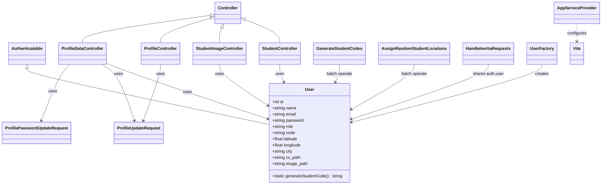

# Diagramme de classes

Résumé du projet
- Application Laravel de gestion d'utilisateurs / étudiants : création, modification, upload/download de CV et images, génération de codes étudiants et commandes d'administration.

## Diagramme (Mermaid)



## Description détaillée des classes

- **`User` — app/Models/User.php**
  - Modèle principal des utilisateurs.
  - Attributs importants : `name`, `email`, `password`, `role`, `code`, `note1/2/3`, `latitude`, `longitude`, `city`, `cv_path`, `image_path`.
  - Méthodes: `generateStudentCode()` crée un code unique; `booted()` assigne automatiquement un code à la création si `role === 'etudiant'`.

- **`StudentController` — app/Http/Controllers/StudentController.php**
  - Endpoints JSON pour : lister étudiants, récupérer détail, créer, mettre à jour, mettre à jour notes, upload/download CV.
  - Valide les données via `request()->validate()` et retourne des réponses structurées.

- **`StudentImageController` — app/Http/Controllers/StudentImageController.php**
  - Gestion upload/download/suppression d'images d'étudiants.
  - Permissions: téléchargement restreint à l'admin ou au propriétaire; insertion d'un log dans `image_downloads`.

- **`ProfileController` — app/Http/Controllers/ProfileController.php**
  - Contrôleur Inertia pour l'interface utilisateur: édition de profil, suppression de compte, redirections.

- **`ProfileDataController` — app/Http/Controllers/ProfileDataController.php**
  - API JSON pour afficher/mettre à jour le profil courant et changer le mot de passe (utilise `ProfileUpdateRequest` et `ProfilePasswordUpdateRequest`).

- **`ProfileUpdateRequest` / `ProfilePasswordUpdateRequest` — app/Http/Requests/**
  - Classes `FormRequest` centralisant les règles de validation pour mise à jour du profil et changement de mot de passe.

- **`GenerateStudentCodes` / `AssignRandomStudentLocations` — app/Console/Commands/**
  - Commandes Artisan pour opérations batch : génération de codes manquants et affectation de coordonnées aléatoires.

- **`HandleInertiaRequests` — app/Http/Middleware/HandleInertiaRequests.php**
  - Middleware qui partage `auth.user` aux props Inertia et gère la version des assets.

- **`AppServiceProvider` — app/Providers/AppServiceProvider.php**
  - Hook bootstrap (ex: `Vite::prefetch`).

- **`UserFactory` — database/factories/UserFactory.php**
  - Génération de fixtures pour les tests / seeders.

## Export / création d'un diagramme visuel
Options pour obtenir une image PNG/SVG depuis le Mermaid ci‑dessus :

- Via VS Code : installer l'extension "Markdown Preview Mermaid Support" et ouvrir `docs/CLASS_DIAGRAM.md` puis exporter la preview.
- Via mermaid-cli :

```bash
npm i -g @mermaid-js/mermaid-cli
mmdc -i docs/CLASS_DIAGRAM.md -o docs/class_diagram.png
```

ou copier seulement le bloc Mermaid dans un fichier `.mmd` et exécuter `mmdc -i diagram.mmd -o diagram.png`.

---
Fichier de référence : [app/Models/User.php](app/Models/User.php)
